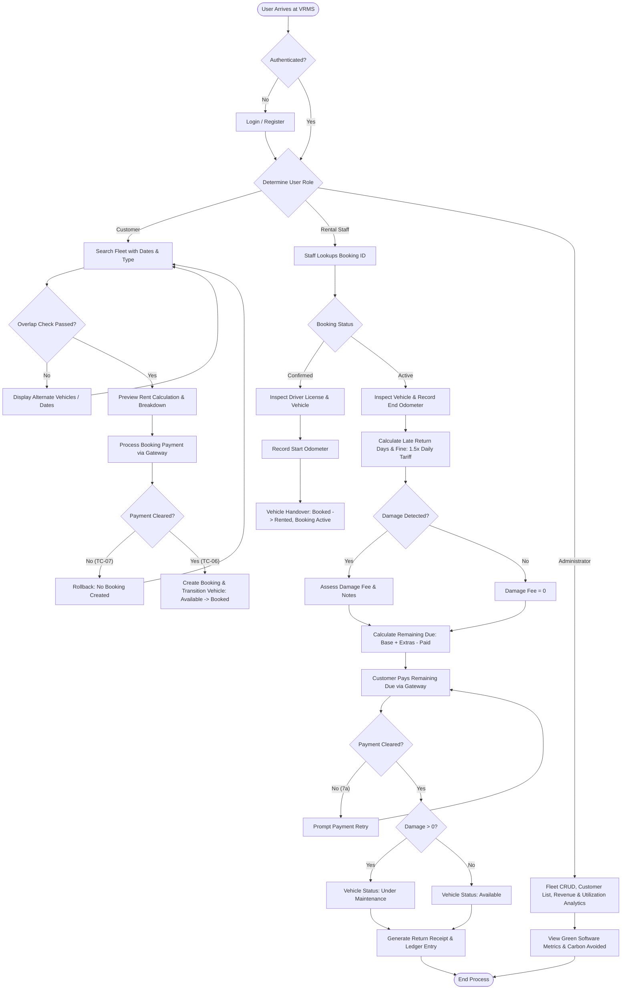

# 01. Problem Statement and High-Level System Flowchart
**Project:** Vehicle Rental Management System (VRMS)  
**Lab:** Software Engineering Lab (CIC-357)  
**Institution:** Maharaja Agrasen Institute of Technology (MAIT), GGSIPU Delhi  

---

## 1. Problem Statement
Many vehicle rental businesses continue to manage bookings, fleet inventory, customer verifications, and payments manually using spreadsheets, paper logbooks, or disconnected point-of-sale systems. This leads to critical operational failures:
1. **Double / Overlapping Bookings:** Simultaneous customer reservations for the same vehicle over conflicting date ranges.
2. **Inaccurate Fleet Availability:** Inability to track when vehicles are undergoing maintenance, retired, or currently rented out.
3. **Payment Reconciliation Errors:** Discrepancies between booking deposits, late-return penalties, and damage fee settlements.
4. **Poor Audit Trails:** Lack of accountability regarding vehicle condition at pickup versus return, odometer readings, and staff sign-offs.

**VRMS** provides a centralized, automated web platform that prevents overlapping bookings through mathematical interval checks, enforces strict finite state machine transitions for vehicles, automates late return fines and damage fee calculation, and optimizes system efficiency using Green Software computing principles.

---

## 2. End-to-End System Flowchart

