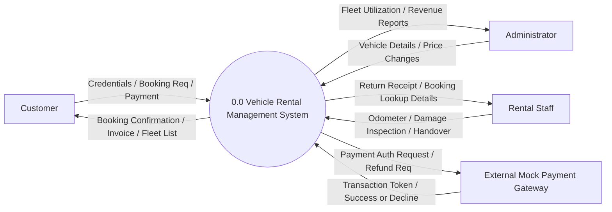
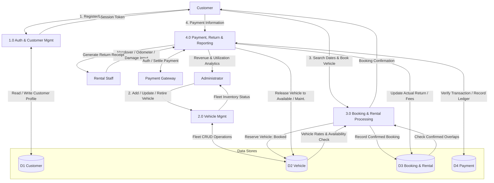

# 03. Data Flow Diagrams (DFD) and Structure Chart
**Project:** Vehicle Rental Management System (VRMS)  
**Lab:** Software Engineering Lab (CIC-357) | MAIT, GGSIPU Delhi  

---

## 1. DFD Level 0 (Context Diagram)

---

## 2. DFD Level 1 (Detailed Subsystem Data Flow)
Processes:
- **1.0 Auth & Customer Management**
- **2.0 Vehicle Fleet Management**
- **3.0 Booking & Rental Processing**
- **4.0 Payment, Return & Reporting**

Data Stores:
- **D1:** Customer Store
- **D2:** Vehicle Store
- **D3:** Booking & Rental Store
- **D4:** Payment Store

---

## 3. Structure Chart (Modular Hierarchy)

```mermaid
graph TD
    Root[VRMS Main Controller / Application Engine]
    
    Root --> M1[Customer & Auth Subsystem]
    Root --> M2[Fleet Management Subsystem]
    Root --> M3[Booking & Availability Subsystem]
    Root --> M4[Rental & Return Subsystem]
    Root --> M5[Financial & Payment Subsystem]
    Root --> M6[Green Computing Engine]

    M1 --> M1_1[Register Customer]
    M1 --> M1_2[Authenticate & Hash Passwords]
    M1 --> M1_3[Update Personal Profile]

    M2 --> M2_1[Add Vehicle]
    M2 --> M2_2[Modify Vehicle Tariff/Status]
    M2 --> M2_3[Retire Vehicle]

    M3 --> M3_1[Evaluate Date Overlap]
    M3 --> M3_2[Calculate Rent: Rate * Days]
    M3 --> M3_3[Cancel Booking & Compute 10% Fee]

    M4 --> M4_1[Pickup Handover: Booked -> Rented]
    M4 --> M4_2[Inspect Return & Odometer]
    M4 --> M4_3[Assess Late Fee & Damage Fee]
    M4 --> M4_4[Print Itemized Return Receipt]

    M5 --> M5_1[Make Mock Payment]
    M5 --> M5_2[Process Cancellation Refund]
    M5 --> M5_3[Aggregate Revenue & Utilization Reports]

    M6 --> M6_1[In-Memory TTL Caching]
    M6 --> M6_2[Selective Field Projection]
    M6 --> M6_3[Measure DB Reads Avoided & Carbon]
```

