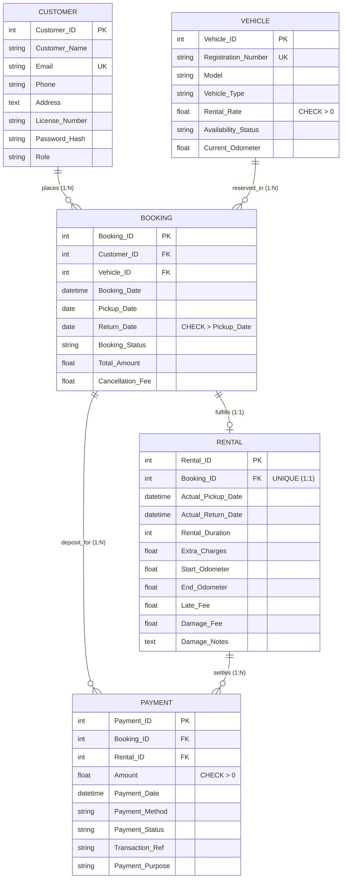

# 04. Entity-Relationship (ER) Diagram & 3NF Relational Schema
**Project:** Vehicle Rental Management System (VRMS)  
**Lab:** Software Engineering Lab (CIC-357) | MAIT, GGSIPU Delhi  

---

## 1. Entity-Relationship (ER) Diagram



---

## 2. 3NF Normalization Analysis
1. **First Normal Form (1NF):**
   - All attribute values are atomic (indivisible scalars).
   - Each record possesses a unique Primary Key (`Customer_ID`, `Vehicle_ID`, `Booking_ID`, `Rental_ID`, `Payment_ID`).
   - No repeating groups or multivalued arrays.
2. **Second Normal Form (2NF):**
   - Satisfies 1NF.
   - All non-key attributes are fully functionally dependent on the entire Primary Key (no partial dependencies on composite keys since single-attribute surrogate keys are used throughout).
3. **Third Normal Form (3NF):**
   - Satisfies 2NF.
   - No transitive functional dependencies exist ($X \to Y \to Z$).
   - Calculated fields (such as remaining due or late fee multipliers) are computed dynamically via domain business logic rather than causing redundant transitive database storage anomalies.

---

## 3. Relational Schema Definition (DDL Specification)

```sql
-- 1. CUSTOMER TABLE
CREATE TABLE customer (
    Customer_ID INTEGER PRIMARY KEY AUTOINCREMENT,
    Customer_Name VARCHAR(100) NOT NULL,
    Email VARCHAR(120) UNIQUE NOT NULL,
    Phone VARCHAR(20) NOT NULL,
    Address TEXT NOT NULL,
    License_Number VARCHAR(50) NOT NULL,
    Password_Hash VARCHAR(255) NOT NULL,
    Role VARCHAR(20) NOT NULL DEFAULT 'Customer',
    Created_At DATETIME DEFAULT CURRENT_TIMESTAMP
);

-- 2. VEHICLE TABLE
CREATE TABLE vehicle (
    Vehicle_ID INTEGER PRIMARY KEY AUTOINCREMENT,
    Registration_Number VARCHAR(50) UNIQUE NOT NULL,
    Model VARCHAR(100) NOT NULL,
    Vehicle_Type VARCHAR(50) NOT NULL,
    Rental_Rate FLOAT NOT NULL,
    Availability_Status VARCHAR(30) NOT NULL DEFAULT 'Available',
    Current_Odometer FLOAT NOT NULL DEFAULT 0.0,
    Image_URL VARCHAR(255),
    Features VARCHAR(255),
    CONSTRAINT check_rental_rate_positive CHECK (Rental_Rate > 0)
);
CREATE INDEX idx_vehicle_status_type ON vehicle(Availability_Status, Vehicle_Type);

-- 3. BOOKING TABLE
CREATE TABLE booking (
    Booking_ID INTEGER PRIMARY KEY AUTOINCREMENT,
    Customer_ID INTEGER NOT NULL REFERENCES customer(Customer_ID),
    Vehicle_ID INTEGER NOT NULL REFERENCES vehicle(Vehicle_ID),
    Booking_Date DATETIME NOT NULL DEFAULT CURRENT_TIMESTAMP,
    Pickup_Date DATE NOT NULL,
    Return_Date DATE NOT NULL,
    Booking_Status VARCHAR(30) NOT NULL DEFAULT 'Confirmed',
    Total_Amount FLOAT NOT NULL,
    Cancellation_Fee FLOAT DEFAULT 0.0,
    CONSTRAINT check_return_after_pickup CHECK (Return_Date > Pickup_Date)
);
CREATE INDEX idx_booking_dates ON booking(Pickup_Date, Return_Date);
CREATE INDEX idx_booking_vehicle_status ON booking(Vehicle_ID, Booking_Status);

-- 4. RENTAL TABLE
CREATE TABLE rental (
    Rental_ID INTEGER PRIMARY KEY AUTOINCREMENT,
    Booking_ID INTEGER UNIQUE NOT NULL REFERENCES booking(Booking_ID),
    Actual_Pickup_Date DATETIME NOT NULL DEFAULT CURRENT_TIMESTAMP,
    Actual_Return_Date DATETIME,
    Rental_Duration INTEGER,
    Extra_Charges FLOAT NOT NULL DEFAULT 0.0,
    Start_Odometer FLOAT NOT NULL DEFAULT 0.0,
    End_Odometer FLOAT,
    Late_Fee FLOAT NOT NULL DEFAULT 0.0,
    Damage_Fee FLOAT NOT NULL DEFAULT 0.0,
    Damage_Notes TEXT
);

-- 5. PAYMENT TABLE
CREATE TABLE payment (
    Payment_ID INTEGER PRIMARY KEY AUTOINCREMENT,
    Booking_ID INTEGER REFERENCES booking(Booking_ID),
    Rental_ID INTEGER REFERENCES rental(Rental_ID),
    Amount FLOAT NOT NULL,
    Payment_Date DATETIME NOT NULL DEFAULT CURRENT_TIMESTAMP,
    Payment_Method VARCHAR(50) NOT NULL,
    Payment_Status VARCHAR(30) NOT NULL DEFAULT 'Completed',
    Transaction_Ref VARCHAR(100),
    Payment_Purpose VARCHAR(50) DEFAULT 'Booking Deposit',
    CONSTRAINT check_payment_amount_positive CHECK (Amount > 0)
);
CREATE INDEX idx_payment_status ON payment(Payment_Status);
```
