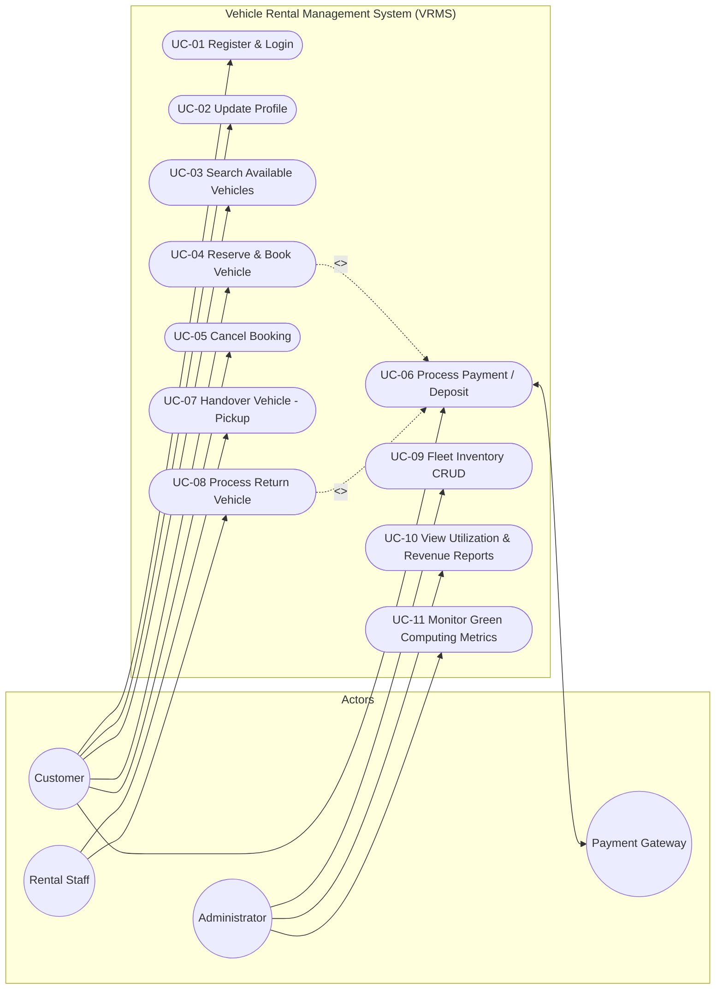

# 05. Use Case Diagram and Formal Specification (UC-08)
**Project:** Vehicle Rental Management System (VRMS)  
**Lab:** Software Engineering Lab (CIC-357) | MAIT, GGSIPU Delhi  

---

## 1. Use Case Diagram

---

## 2. Formal Specification: Use Case UC-08 (Return Vehicle)

| Attribute | Details |
|---|---|
| **Use Case ID** | **UC-08** |
| **Use Case Name** | Return Vehicle and Final Settlement |
| **Primary Actor** | Rental Staff |
| **Secondary Actors**| Customer, Payment Gateway |
| **Trigger** | Customer arrives at rental counter to return vehicle after rental period. |
| **Preconditions** | 1. Booking exists with status `Active`. 2. Vehicle is currently in `Rented` state. 3. Rental record exists with recorded start odometer reading. |
| **Postconditions** | 1. Vehicle status updated to `Available` (or `Under Maintenance` if damaged). 2. Booking status transitioned to `Completed`. 3. Remaining charges collected and transaction logged. 4. Official return receipt generated. |

### Main Success Scenario (Basic Flow)
1. Rental staff accesses staff counter and enters `Booking_ID`.
2. VRMS validates `Booking_ID`, retrieves booking contract, associated vehicle specifications, and initial deposit payment records.
3. Staff physically inspects vehicle and enters closing odometer reading ($O_{end}$).
4. System verifies that $O_{end} \ge O_{start}$ and computes total distance traveled.
5. System verifies vehicle condition is normal (zero damage) and vehicle is returned on or before scheduled return date (zero late fee).
6. System calculates remaining financial balance:
   $$\text{Remaining Due} = \max(0, \text{Total Contract Amount} - \text{Deposit Paid})$$
7. Customer confirms payment method and staff submits settlement.
8. System invokes `PaymentGateway.makePayment(remaining)` and receives transaction confirmation token.
9. System transitions vehicle status: `Rented` $\to$ `Available`.
10. System records actual return timestamp, marks booking as `Completed`, and generates printable return receipt.

### Alternate Flows
- **5a. Late Return Fine Assessment:**
  1. System compares `Actual_Return_Date` against scheduled `Return_Date`.
  2. If $\text{Actual\_Date} > \text{Scheduled\_Date}$:
     $$\text{Late Days} = \text{Actual\_Date} - \text{Scheduled\_Date}$$
     $$\text{Late Fee} = \text{Late Days} \times (\text{Daily Tariff} \times 1.5)$$
  3. System appends $\text{Late Fee}$ to extra charges and updates remaining balance.
  4. Flow resumes at Step 6.

- **5b. Vehicle Damage Identified:**
  1. Staff notes physical dents/scratches and enters damage assessment amount and remarks.
  2. System adds $\text{Damage Fee}$ to extra charges.
  3. Vehicle state machine destination is updated: instead of `Available`, vehicle transitions from `Rented` $\to$ `Under Maintenance`.
  4. Flow resumes at Step 6.

- **7a. Payment Gateway Decline (Failure Retry):**
  1. External payment gateway declines transaction (insufficient funds / network error).
  2. VRMS alerts staff with `"Payment Failed: Transaction declined by gateway"`.
  3. Staff offers customer alternate payment method (e.g. UPI, Debit Card, or Cash Handover).
  4. Payment is retried until successfully cleared.
  5. Flow resumes at Step 8.

### Exception Flows
- **E1. Booking ID Not Found:** System displays error `"Booking ID not found"` and prompts staff to re-check identifier.
- **E2. Invalid Odometer Reading:** If $O_{end} < O_{start}$, system rejects submission with error `"Closing odometer cannot be less than opening odometer"`.
