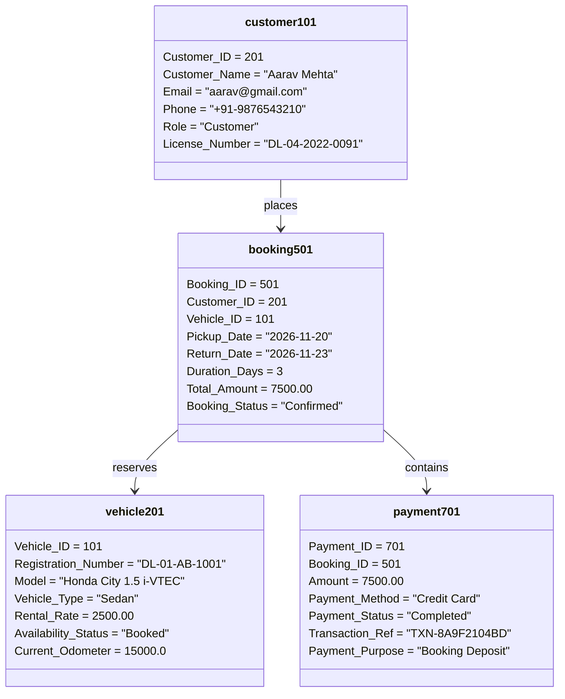

# 06. Class Diagram and Object Diagram
**Project:** Vehicle Rental Management System (VRMS)  
**Lab:** Software Engineering Lab (CIC-357) | MAIT, GGSIPU Delhi  

---

## 1. Object-Oriented Class Diagram

```mermaid
classDiagram
    class Customer {
        +int Customer_ID
        +string Customer_Name
        +string Email
        +string Phone
        +string Address
        +string License_Number
        +string Password_Hash
        +string Role
        +set_password(password)
        +check_password(password) bool
        +to_dict() dict
    }

    class Administrator {
        +manageVehicles()
        +viewReports()
    }

    class RentalStaff {
        +verifyBooking(booking_id)
        +pickupVehicle(booking_id, odo)
        +returnVehicle(booking_id, odo, damage)
    }

    class Vehicle {
        +int Vehicle_ID
        +string Registration_Number
        +string Model
        +string Vehicle_Type
        +float Rental_Rate
        +string Availability_Status
        +float Current_Odometer
        +book_vehicle()
        +pickup_vehicle()
        +return_vehicle()
        +report_damage()
        +complete_maintenance()
        +retire_vehicle()
        +calculateRent(days) float
        +to_dict(full) dict
    }

    class Booking {
        +int Booking_ID
        +int Customer_ID
        +int Vehicle_ID
        +datetime Booking_Date
        +date Pickup_Date
        +date Return_Date
        +string Booking_Status
        +float Total_Amount
        +float Cancellation_Fee
        +duration_days int
        +to_dict() dict
    }

    class Rental {
        +int Rental_ID
        +int Booking_ID
        +datetime Actual_Pickup_Date
        +datetime Actual_Return_Date
        +int Rental_Duration
        +float Extra_Charges
        +float Start_Odometer
        +float End_Odometer
        +float Late_Fee
        +float Damage_Fee
        +string Damage_Notes
        +to_dict() dict
    }

    class Payment {
        +int Payment_ID
        +int Booking_ID
        +int Rental_ID
        +float Amount
        +datetime Payment_Date
        +string Payment_Method
        +string Payment_Status
        +string Transaction_Ref
        +string Payment_Purpose
        +to_dict() dict
    }

    class PaymentGateway {
        <<Service>>
        +makePayment(amount, method, simulate_failure) dict
        +refundPayment(txn_ref, amount) dict
    }

    class VehicleDB {
        <<Data Access & Green Caching>>
        +getVehicle(vehicle_id, use_cache) Vehicle
        +searchVehicle(type) List~Vehicle~
        +searchAvailableVehicles(p_date, r_date, type, page) dict
        +isVehicleAvailable(vehicle_id, p_date, r_date) bool
        +addVehicle(...) Vehicle
        +updateVehicle(...) Vehicle
        +deactivateVehicle(vehicle_id) Vehicle
    }

    class BookingService {
        <<Domain Controller>>
        +calculateRent(daily_rate, days) float
        +checkAvailability(vehicle_id, p_date, r_date) bool
        +bookVehicle(cust_id, veh_id, p_date, r_date, method) Booking
        +pickupVehicle(booking_id, staff_id, start_odo) Rental
        +returnVehicle(booking_id, staff_id, end_odo, damage) dict
        +cancelBooking(booking_id, cust_id) Booking
    }

    Customer <|-- Administrator : Inheritance
    Customer <|-- RentalStaff : Inheritance
    Customer "1" --> "*" Booking : places
    Vehicle "1" --> "*" Booking : reserved_in
    Booking "1" *-- "1" Rental : composition (1:1)
    Booking "1" *-- "*" Payment : composition (1:N)
    Rental "1" --> "*" Payment : settles
    RentalStaff ..> BookingService : manages bookings
    Administrator ..> VehicleDB : manages fleet
    BookingService ..> PaymentGateway : processes transactions
    BookingService ..> VehicleDB : queries inventory
```

---

## 2. Object Diagram (Runtime Instance Snapshot)

Demonstrating live test scenario instances: Customer 201 / 101, Vehicle 101 / 201, Booking 501, and Payment 701.


