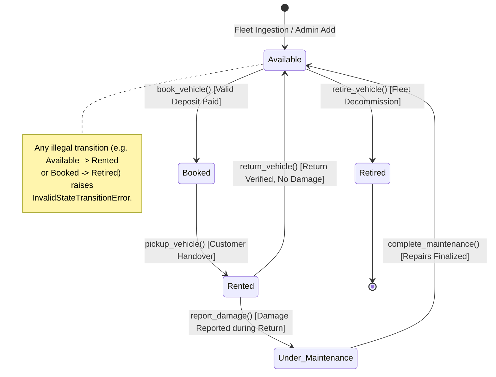
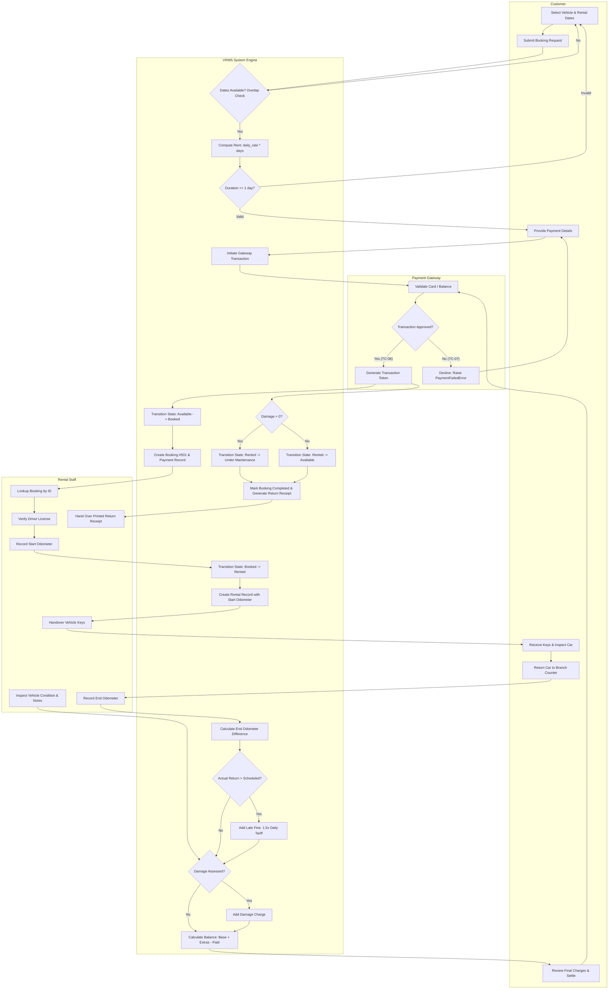

# 07. State-Chart and Activity Diagram
**Project:** Vehicle Rental Management System (VRMS)  
**Lab:** Software Engineering Lab (CIC-357) | MAIT, GGSIPU Delhi  

---

## 1. Vehicle Finite State Machine (State-Chart Diagram)

---

## 2. Activity Diagram with Swimlanes

Demonstrating the integrated operational workflow across the 4 primary actors/subsystems: **Customer, VRMS, Payment Gateway, and Rental Staff**.

