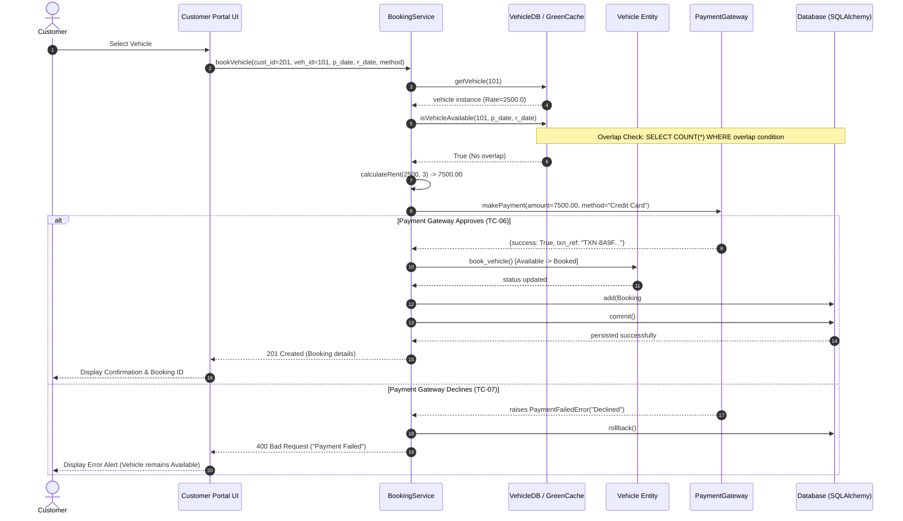

# 08. Sequence and Collaboration Diagrams (Booking Flow)
**Project:** Vehicle Rental Management System (VRMS)  
**Lab:** Software Engineering Lab (CIC-357) | MAIT, GGSIPU Delhi  

---

## 1. Sequence Diagram (Booking Flow)



---

## 2. Collaboration (Communication) Diagram

Illustrating the structural organization of objects participating in the booking workflow with numbered messages:

```mermaid
flowchart LR
    Customer((1: Customer))
    Service((2: BookingService))
    VDB((3: VehicleDB))
    Vehicle((4: Vehicle #101))
    PG((5: PaymentGateway))
    DB[((6: DB / SQLAlchemy))]

    Customer -- "1: bookVehicle(201, 101, 3d)" --> Service
    Service -- "1.1: getVehicle(101)<br>1.2: isVehicleAvailable()" --> VDB
    VDB -- "1.2.1: query overlaps" --> DB
    Service -- "1.3: makePayment(7500)" --> PG
    PG -- "1.3.1: auth approved" --> Service
    Service -- "1.4: book_vehicle()" --> Vehicle
    Service -- "1.5: persist Booking & Payment" --> DB
    Service -- "1.6: return confirmed booking" --> Customer
```
