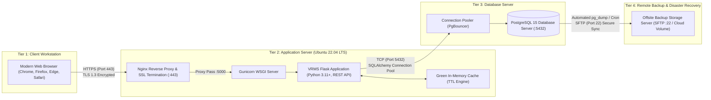

# 10. Deployment Diagram
**Project:** Vehicle Rental Management System (VRMS)  
**Lab:** Software Engineering Lab (CIC-357) | MAIT, GGSIPU Delhi  

---

## 1. Physical Deployment Architecture

---

## 2. Infrastructure Specification

| Component | Operating Environment | Port | Protocol | Purpose |
|---|---|---|---|---|
| **Client Workstation** | Windows 10/11, macOS, Linux | Dynamic | HTTPS | User interface access (Customer, Admin, Staff) |
| **Web Server (Reverse Proxy)** | Ubuntu 22.04 LTS / Nginx | 443 | HTTPS | TLS certificate termination, static asset caching |
| **Application Server** | Ubuntu 22.04 LTS / Docker | 5000 | HTTP / WSGI | Flask REST API, domain state machine, green caching |
| **Database Server** | PostgreSQL 15 Engine | 5432 | TCP | ACID relational persistence, CHECK constraints, indexes |
| **Disaster Recovery** | SFTP / Backup Volume | 22 | SFTP | Nightly automated database dumps and schema recovery |
