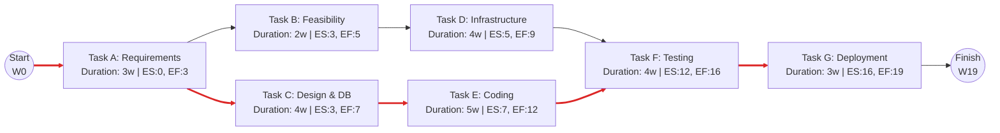
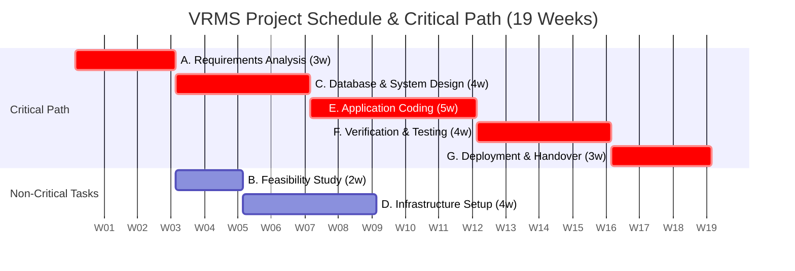

# 12. Project Management: WBS, Gantt Chart, and PERT/CPM Network
**Project:** Vehicle Rental Management System (VRMS)  
**Lab:** Software Engineering Lab (CIC-357) | MAIT, GGSIPU Delhi  

---

## 1. Work Breakdown Structure (WBS)

```mermaid
graph TD
    VRMS[1.0 Vehicle Rental Management System]

    VRMS --> T_A[1.1 Requirements Analysis - Task A]
    T_A --> A1[1.1.1 Stakeholder Interviews & Problem Statement]
    T_A --> A2[1.1.2 IEEE 830 SRS & Use Case Modeling]

    VRMS --> T_B[1.2 Feasibility Study - Task B]
    T_B --> B1[1.2.1 Technical & Operational Feasibility]
    T_B --> B2[1.2.2 Economic Cost-Benefit Analysis]

    VRMS --> T_C[1.3 Database & System Design - Task C]
    T_C --> C1[1.3.1 3NF Relational Schema & Constraints]
    T_C --> C2[1.3.2 UML Class & Sequence Diagrams]
    T_C --> C3[1.3.3 Vehicle FSM Architecture]

    VRMS --> T_D[1.4 Infrastructure & Green Setup - Task D]
    T_D --> D1[1.4.1 Docker Containerization & PostgreSQL Setup]
    T_D --> D2[1.4.2 In-Memory TTL Cache Configuration]

    VRMS --> T_E[1.5 Application Coding - Task E]
    T_E --> E1[1.5.1 Flask REST API Blueprints]
    T_E --> E2[1.5.2 Booking Engine & Overlap Algorithms]
    T_E --> E3[1.5.3 Responsive Frontend HTML/CSS/JS]

    VRMS --> T_F[1.6 Verification & Testing - Task F]
    T_F --> F1[1.6.1 Unit & ECP Tests TC-01..TC-05]
    T_F --> F2[1.6.2 Integration Tests TC-06..TC-08]
    T_F --> F3[1.6.3 Data Flow DU-Chain Tests DF-01..DF-06]

    VRMS --> T_G[1.7 Deployment & Handover - Task G]
    T_G --> G1[1.7.1 Automated Backup & Disaster Recovery Tests]
    T_G --> G2[1.7.2 Lab Demonstration & Documentation Review]
```

---

## 2. Activity Schedule, CPM Time Analysis & Slack Table

| Task | Task Description | Duration ($t$) | Predecessors | Earliest Start (ES) | Earliest Finish (EF) | Latest Start (LS) | Latest Finish (LF) | Total Slack ($S = LS - ES$) | Critical Path? |
|---|---|---|---|---|---|---|---|---|---|
| **A** | Requirements Analysis | 3 weeks | None | 0 | 3 | 0 | 3 | 0 | **YES (Critical)** |
| **B** | Feasibility Study | 2 weeks | A | 3 | 5 | 6 | 8 | 3 weeks | No (Slack = 3) |
| **C** | Database & Design | 4 weeks | A | 3 | 7 | 3 | 7 | 0 | **YES (Critical)** |
| **D** | Infrastructure Setup | 4 weeks | B | 5 | 9 | 8 | 12 | 3 weeks | No (Slack = 3) |
| **E** | Application Coding | 5 weeks | C | 7 | 12 | 7 | 12 | 0 | **YES (Critical)** |
| **F** | Comprehensive Testing | 4 weeks | E, D | 12 | 16 | 12 | 16 | 0 | **YES (Critical)** |
| **G** | Final Deployment | 3 weeks | F | 16 | 19 | 16 | 19 | 0 | **YES (Critical)** |

### Critical Path Determination:
Path 1: $A \to B \to D \to F \to G = 3 + 2 + 4 + 4 + 3 = 16\text{ weeks}$  
Path 2: $A \to C \to E \to F \to G = 3 + 4 + 5 + 4 + 3 = \mathbf{19\text{ weeks}}$  

$$\text{Critical Path} = \mathbf{A \to C \to E \to F \to G} \quad (\mathbf{Total\ Duration = 19\ weeks})$$

---

## 3. PERT / CPM Network Diagram

---

## 4. Project Schedule Gantt Chart

