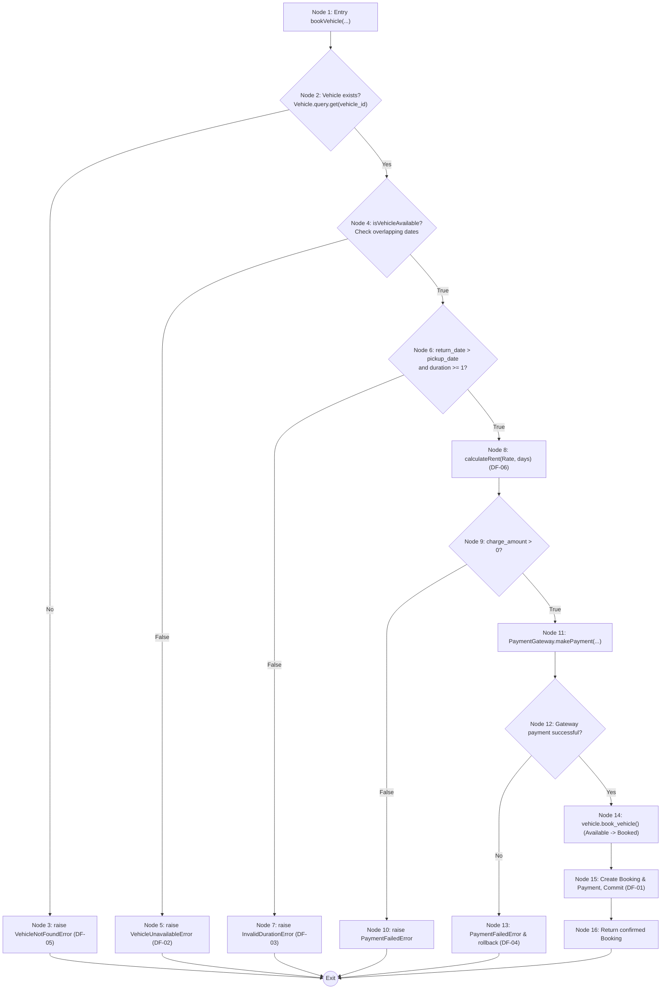

# 13. Data Flow Testing: DEF-USE Table, DU Chains, and Control Flow Graph
**Project:** Vehicle Rental Management System (VRMS)  
**Lab:** Software Engineering Lab (CIC-357) | MAIT, GGSIPU Delhi  

---

## 1. Control Flow Graph (CFG) for `bookVehicle()`

---

## 2. DEF-USE Variable Association Table

| Variable | Definition Node | Usage Node | Usage Type ($c$-use / $p$-use) | Description |
|---|---|---|---|---|
| `vehicle_id` | Node 1 | Node 2, Node 4, Node 15 | $c$-use, $p$-use | Vehicle identifier passed as argument |
| `vehicle` | Node 2 | Node 4, Node 8, Node 14 | $c$-use, $p$-use | Vehicle database entity instance |
| `pickup_date` | Node 1 | Node 4, Node 6, Node 15 | $c$-use, $p$-use | Starting date of rental interval |
| `return_date` | Node 1 | Node 4, Node 6, Node 15 | $c$-use, $p$-use | Ending date of rental interval |
| `duration_days` | Node 6 | Node 6, Node 8, Node 15 | $p$-use, $c$-use | Computed difference: $(Return - Pickup)$ |
| `total_rent` | Node 8 | Node 9, Node 11, Node 15 | $c$-use, $p$-use | Base financial charge: $Rate \times days$ |
| `charge_amount` | Node 8 | Node 9, Node 11, Node 15 | $p$-use, $c$-use | Amount sent to payment gateway |
| `payment_result` | Node 11 | Node 12, Node 15 | $p$-use, $c$-use | Token & status returned by gateway |
| `booking` | Node 15 | Node 16 | $c$-use | Persisted booking contract instance |

---

## 3. Definition-Use (DU) Chains and Data-Flow Test Cases

| Test ID | Target DU-Chain | Path Traversed | Input Values | Expected Result | Status |
|---|---|---|---|---|---|
| **DF-01** | `[total_rent: (N8, N15)]`, `[booking: (N15, N16)]` | 1-2-4-6-8-9-11-12-14-15-16 | `Vehicle_ID=101`, `Days=3`, valid payment | Booking confirmed, total 7500.00 | **PASS** |
| **DF-02** | `[pickup_date, return_date: (N1, N4)]` | 1-2-4-5 | `Vehicle_ID=101`, overlapping dates | `VehicleUnavailableError` | **PASS** |
| **DF-03** | `[duration_days: (N6, N7)]` | 1-2-4-6-7 | `pickup_date == return_date` (0 days) | `InvalidDurationError` | **PASS** |
| **DF-04** | `[payment_result: (N11, N12-N13)]` | 1-2-4-6-8-9-11-12-13 | `simulate_payment_failure=True` | `PaymentFailedError` & rollback | **PASS** |
| **DF-05** | `[vehicle_id: (N1, N2-N3)]` | 1-2-3 | `Vehicle_ID=999` (non-existent) | `VehicleNotFoundError` | **PASS** |
| **DF-06** | `[Rate, days: (N8, N8)]` | 1-2-4-6-8 | `Rate=2500`, `Days=3` | $\text{Rent} = 2500 \times 3 = 7500.00$ | **PASS** |

### Test Execution Verification
All 6 Data Flow tests (**DF-01 through DF-06**) are implemented in `tests/test_data_flow.py` and run as part of the automated test runner `run_tests.py` with 100% pass rate.
